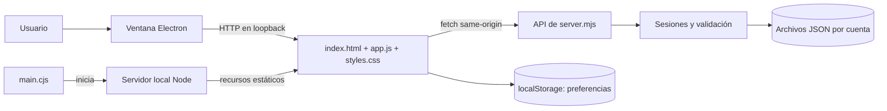
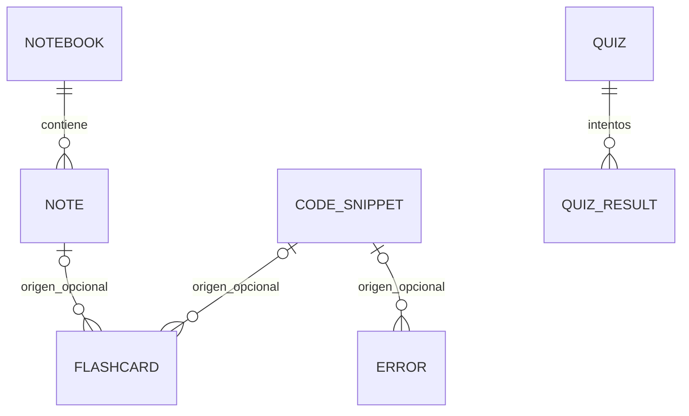

# KORA · Manual técnico

**Aplicación:** KORA · Trippy Animations 1.0.0  
**Proyecto fuente:** `trippy-animations-nuevo`  
**Destinatarios:** desarrollo, despliegue y mantenimiento

> La documentación describe el código fuente actual de `trippy-animations-nuevo`, incluida su distribución Electron portátil. Esta aplicación es independiente de la distribución KORA compilada anterior, que utiliza otro frontend y almacenamiento IndexedDB. No existe migración automática entre ambos formatos.

## 1. Descripción general

KORA es una aplicación de estudio local con frontend en JavaScript, CSS y HTML; un servidor HTTP escrito con módulos estándar de Node.js; y una ventana Electron opcional. El servidor expone archivos estáticos y una API autenticada. El estado de dominio se guarda como JSON por usuario. El renderer guarda por separado las preferencias visuales en `localStorage`.

No hay una base de datos SQL, framework web de servidor ni servicio remoto requerido. El código de programación almacenado es material de estudio y no se ejecuta en KORA.

## 2. Arquitectura



### Ejecución en Electron

`main.cjs` importa `createAppServer`, crea una clave temporal para la configuración inicial, fija `%APPDATA%\KORA-Trippy-Animations` como directorio de datos de Electron e inicia el servidor en un puerto dinámico de `127.0.0.1`. Si todavía no hay cuenta, agrega la clave temporal a la URL inicial. Después crea una `BrowserWindow` que carga la interfaz servida localmente.

La ventana usa `contextIsolation: true`, `nodeIntegration: false` y `sandbox: true`. Los enlaces externos HTTP/HTTPS se abren en el navegador del sistema; la ventana bloquea la navegación a otros orígenes.

### Ejecución con Node

`npm start` carga `.env` con `--env-file-if-exists`, crea las credenciales desde el entorno y escucha por defecto en `127.0.0.1:4173`. Esta ruta sirve la misma interfaz a un navegador y persiste datos en `TRIPPY_DATA_DIR`.

## 3. Tecnologías y herramientas

| Tecnología | Uso en el proyecto |
|---|---|
| JavaScript ES Modules | Frontend (`public\app.js`), servidor (`server.mjs`) y validador (`state-validation.mjs`). |
| Node.js >=22.11 | Servidor HTTP, APIs de sistema de archivos, criptografía y scripts npm. |
| Electron | Proceso principal CommonJS en `main.cjs` y ventana de escritorio. El script reutiliza el runtime entregado junto al proyecto; el paquete fuente no declara un paquete npm de Electron. |
| HTML y CSS | Estructura, presentación adaptable, temas y editor de código. |
| JSON | Persistencia local del estado por cuenta y formato de copia de seguridad. |
| PowerShell | Construcción de la carpeta portátil con `scripts\build-portable.ps1`. |
| Node Test Runner | Pruebas integradas mediante `node --test`, sin framework de pruebas externo. |

No se declara React, Express, ORM ni dependencia npm de terceros en `package.json`.

## 4. Estructura del proyecto

```text
trippy-animations-nuevo/
├── .env.example                 # Configuración de referencia
├── .gitignore                   # Excluye .env, data, node_modules
├── LEEME.txt                    # Primer uso de la distribución
├── README.md                    # Desarrollo, configuración y construcción
├── main.cjs                     # Proceso principal Electron
├── package.json                 # Metadatos, scripts y mínimo de Node
├── server.mjs                   # Servidor HTTP, API, autenticación y JSON
├── state-validation.mjs         # Esquema, normalización y límites del estado
├── public/
│   ├── index.html               # Entrada del frontend
│   ├── app.js                   # Estado, navegación, formularios y acciones
│   ├── styles.css               # Estilos adaptables y temas
│   └── fonts/                   # Atkinson y Fraunces incluidos
├── scripts/
│   └── build-portable.ps1       # Ensamble de la distribución Electron
└── tests/
    └── server.test.mjs          # Pruebas de API, acceso y persistencia
```

`release\` se crea al construir. `data\` se crea al usar el servidor de desarrollo si se conserva el valor predeterminado; está excluida de Git.

## 5. Módulos del frontend

`public\app.js` mantiene el estado de la sesión, los datos cargados, la vista activa y las preferencias. El renderizado se realiza mediante funciones que escriben el HTML en `#app`; los formularios y cuadros de diálogo se montan en `#modal-root`. Los eventos principales usan delegación en el documento, `#app` y `#modal-root`.

| Módulo | Función técnica |
|---|---|
| Resumen | Conteos de cuadernos/apuntes, estados y elementos recientes. |
| Cuadernos y apuntes | CRUD, filtros por nombre o contenido, estados y etiquetas. `notes.notebookId` referencia un cuaderno. |
| Buscador | Búsqueda por términos en cinco colecciones, sugerencias, clasificación por tipo y resaltado escapado de coincidencias. |
| Código | Editor de texto superpuesto a una capa de resaltado; gestiona lenguajes, línea actual, indentación, búsqueda, portapapeles, descarga y versiones. |
| Errores | CRUD de registros pendientes/solucionados y vínculo opcional al código de origen. |
| Estudio | Tarjetas, filtro por tema, valoraciones, cuestionarios y resultados recientes. |
| Papelera | Eliminación lógica de apuntes, códigos, errores y cuadernos; restauración o confirmación de borrado permanente. |
| Progreso | Gráficos SVG/CSS derivados de estados y cantidades de apuntes. |
| Accesibilidad | Tema, filtros visuales, contraste, seis escalas de texto y otras preferencias. |
| Mis datos | Exportación e importación de copias JSON. |

El resaltado de sintaxis es un tokenizer local basado en expresiones regulares, no un parser completo ni un servicio de lenguaje. En el editor de código, `textarea.code-input` se superpone a `pre.code-highlight`; el texto transparente permite que se vea el resaltado subyacente, mientras el caret y la selección siguen disponibles.

### Vista previa de apuntes

Las tarjetas de apuntes del resumen y del cuaderno usan `noteCard()` para presentar el título, la vista previa y los metadatos. `notePreview()` limita la entrada a 480 caracteres y agrega una elipsis cuando hay más contenido; CSS limita la altura visible para conservar tarjetas compactas. `safeMarkdown()` escapa primero el contenido con `escapeHtml()` y luego representa un subconjunto controlado de Markdown: encabezados de nivel 1 a 3, párrafos, negrita, cursiva, código en línea o cercado, citas y listas ordenadas o sin ordenar. No procesa HTML proporcionado por la persona usuaria ni ofrece una vista en vivo mientras se edita.

El botón del título tiene un estilo propio en `.note-title-button` para evitar el fondo y borde nativos del navegador; su subrayado usa el color del cuaderno. Los estilos de la vista previa están agrupados bajo `.note-preview` y `.note-preview-content` en `public\styles.css`.

## 6. API y flujo de solicitudes

La función `api()` del frontend envía solicitudes same-origin e interpreta errores JSON. Las rutas implementadas son:

| Método y ruta | Autenticación | Propósito |
|---|---|---|
| `GET /api/status` | No | Indica si se debe realizar la configuración inicial. |
| `POST /api/setup` | Clave temporal en Electron | Configura la única cuenta `sarharf`, solo una vez. |
| `POST /api/login` | No | Verifica usuario/contraseña y establece cookie de sesión. |
| `POST /api/logout` | Cookie, si existe | Invalida la sesión actual y caduca la cookie. |
| `GET /api/me` | Sí | Devuelve el nombre de la cuenta autenticada. |
| `GET /api/state` | Sí | Carga y normaliza el estado JSON de esa cuenta. |
| `PUT /api/state` | Sí | Valida y escribe el estado completo. |

Las solicitudes `POST`, `PUT` y `DELETE` deben tener un origen coincidente con `TRIPPY_PUBLIC_ORIGIN` o, si no se configuró uno, con el origen HTTP de la solicitud. El cuerpo JSON tiene un límite de 6 MiB. Los recursos estáticos solo admiten `GET` y `HEAD`.

## 7. Persistencia y modelo de datos

### 7.1 Formato y archivos

`state-validation.mjs` mantiene `version: 1`. El estado contiene las colecciones `notebooks`, `notes`, `codeSnippets`, `errors`, `flashcards`, `quizzes`, `quizResults` y `trash`. Si un estado antiguo de versión 1 no contiene una colección nueva, el validador la inicializa vacía.

El archivo de cada cuenta usa como nombre el usuario codificado en hexadecimal. `sarharf` se almacena como `73617268617266.json`. En Electron, los datos viven bajo `%APPDATA%\KORA-Trippy-Animations\data\`; en desarrollo, bajo `TRIPPY_DATA_DIR` (por defecto `.\data\`). La escritura usa archivos temporales y renombrado atómico; las escrituras de una cuenta se serializan mediante una cola y el servidor conserva una caché en memoria.

### 7.2 Diagrama lógico



El diagrama representa referencias por identificador, no restricciones de una base relacional. La validación sí exige que `notes.notebookId` corresponda a un cuaderno presente. Los campos `sourceNoteId`, `sourceSnippetId`, `sourceCodeId` y `quizId` se guardan como referencias, pero no se verifica que su destino exista en todas las operaciones. La papelera almacena una copia del elemento eliminado; un cuaderno incluye una lista anidada de sus apuntes.

### 7.3 Diccionario de datos

| Colección | Campos principales | Reglas relevantes |
|---|---|---|
| `notebooks` | `id`, `name`, `color`, `createdAt`, `updatedAt` | ID único; nombre requerido hasta 80 caracteres; color de la paleta soportada. |
| `notes` | `id`, `notebookId`, `title`, `bodyMd`, `status`, `tags`, fechas | ID único; cuaderno existente; título requerido hasta 160; cuerpo hasta 200 000; estado `nuevo`, `repaso` o `dominado`; hasta 12 etiquetas normalizadas. |
| `codeSnippets` | `id`, `title`, `description`, `language`, `code`, `category`, `topic`, `tags`, `explanation`, `comments`, `versions`, fechas | Hasta 500; código hasta 200 000 caracteres; descripción 2 000, explicación 20 000, comentarios 12 000; hasta 30 versiones. |
| `errors` | `id`, `title`, `description`, `code`, `message`, `language`, `solution`, `fixedCode`, `category`, `topic`, `tags`, `status`, `sourceCodeId`, fechas | Hasta 2 000; título requerido; estado `pending` o `solved`; los campos de texto tienen máximos propios validados. |
| `flashcards` | `id`, `front`, `back`, `topic`, `status`, referencias de origen, `reviewedAt`, fechas | Hasta 10 000; frente y reverso requeridos; estado `new`, `review` o `known`. |
| `quizzes` | `id`, `title`, `topic`, `questions`, fechas | Hasta 500 cuestionarios; título requerido; de 1 a 100 preguntas. |
| `questions` (anidadas) | `id`, `prompt`, `type`, `options`, `correctIndex`, `explanation` | Tipos `multiple`/`true-false`; opciones de selección múltiple entre 2 y 6; verdadero/falso exactamente 2. |
| `quizResults` | `id`, `quizId`, `score`, `total`, `answers`, `completedAt` | Hasta 10 000; `0 ≤ score ≤ total`; `answers` tiene `total` posiciones; `-1` representa pregunta sin responder. |
| `trash` | `id`, `kind`, `item`, `deletedAt` | Hasta 10 000; `kind`: `note`, `code`, `error` o `notebook`; conserva una copia del elemento. |

Los límites anteriores son validaciones del servidor; el formulario puede limitar algunos campos antes de enviar el estado.

## 8. Autenticación, autorización y seguridad

- Solo se admite el usuario `sarharf`; no hay roles ni registro público.
- La contraseña tiene entre 8 y 1024 caracteres. Node la deriva mediante `scrypt` con sal aleatoria de 16 bytes y salida de 64 bytes.
- La comparación de hashes usa `timingSafeEqual`. `accounts.json` guarda sal y hash, no contraseña en claro.
- El acceso limita ocho fallos por dirección durante una ventana de 15 minutos. El contador y las sesiones viven en memoria y se reinician al cerrar el proceso.
- La cookie es `HttpOnly`, `SameSite=Strict`, de hasta ocho horas; `Secure` se agrega cuando `TRIPPY_SECURE_COOKIE=true`.
- La interfaz envía secretos de acceso al servidor local; no los incluye en el JavaScript servido.
- El servidor aplica una CSP restrictiva, `nosniff`, validación de origen en métodos mutables y comprobación de rutas estáticas bajo `publicRoot`.
- Electron usa aislamiento de contexto, integración Node deshabilitada, sandbox y navegación externa controlada.

El modo de desarrollo lee la contraseña desde `.env`, que debe protegerse como secreto local. El servidor HTTP no incorpora TLS; no lo expongas directamente a redes públicas. Una configuración de proxy, servicio Windows o perímetro de producción no forma parte del proyecto.

## 9. Validación y manejo de errores

`validateState()` comprueba el tipo de cada colección, límites de cantidades, campos requeridos, longitudes, identificadores duplicados y referencias de apuntes a cuadernos. Normaliza fechas inválidas al momento actual y completa colecciones nuevas ausentes.

El servidor devuelve estados HTTP explícitos: 400 para JSON o datos inválidos, 401 para falta de sesión/credenciales, 403 para origen o clave no autorizados, 409 para configurar una cuenta ya existente, 413 para cuerpo demasiado grande, 415 para tipo de contenido inesperado, 429 para demasiados accesos y 500 para errores internos. Las excepciones se registran mediante `logger`; los errores no se convierten en estados de éxito.

El frontend muestra mensajes de formulario o notificaciones. `updateState()` conserva una copia previa del estado; si el servidor rechaza la escritura, restaura ese estado y presenta el error.

## 10. Configuración de desarrollo y construcción

Scripts declarados en `package.json`:

| Script | Acción |
|---|---|
| `npm start` | Inicia `server.mjs` cargando `.env` si existe. |
| `npm test` | Ejecuta `node --test`. |
| `npm run build:portable` | Llama al script PowerShell para ensamblar el ejecutable de Windows. |

Para instrucciones reproducibles de Node, `.env`, runtime esperado, salida y despliegue, consulta el [Manual de despliegue](./MANUAL_DESPLIEGUE.md). El proyecto fuente local también incluye un `README.md`, que no se publica en este repositorio.

## 11. Consideraciones de mantenimiento

- Antes de alterar `version: 1` o las colecciones, conserva lectura de los estados existentes y agrega pruebas de normalización.
- Mantén límites coherentes entre formularios, `state-validation.mjs`, el importador y el máximo de cuerpo HTTP.
- No ejecutes código guardado ni lo evalúes como JavaScript; es contenido aportado por la persona usuaria.
- Si cambias la clase o estructura del editor superpuesto, valida que `textarea.code-input`, `pre.code-highlight` y el gutter coincidan en tamaño y desplazamiento.
- Verifica restauración de copias JSON en una instancia de prueba antes de publicar cambios.
- Para actualizar el ejecutable, conserva separado el runtime, la aplicación y `%APPDATA%\KORA-Trippy-Animations`; valida la salida completa y el arranque.
- La aplicación antigua usa IndexedDB y no comparte el modelo JSON. Cualquier migración futura debe diseñarse, validarse y probarse como una función específica; no basta con copiar archivos.

## 12. Referencias

- [Manual de usuario](./MANUAL_USUARIO.md)
- [Manual de despliegue](./MANUAL_DESPLIEGUE.md)
